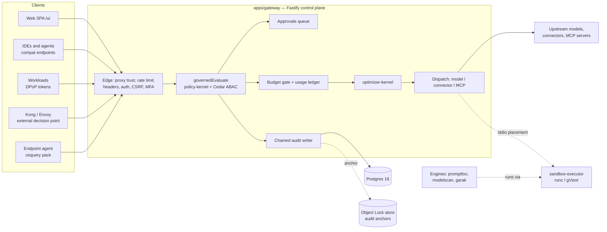
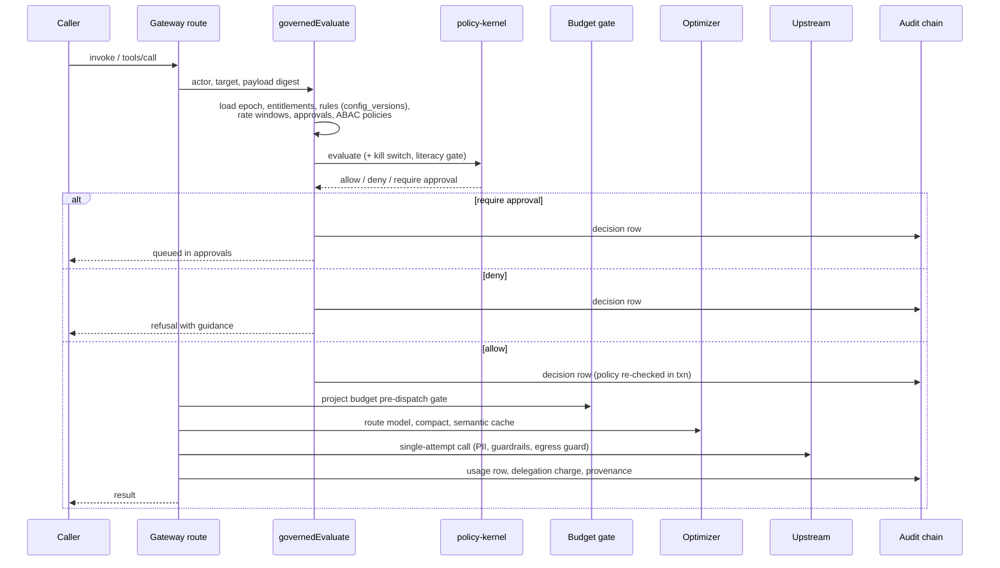
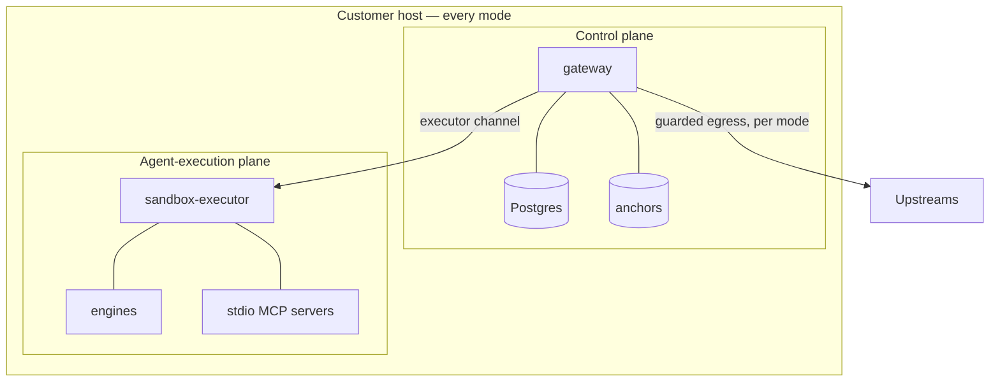

# RegulAIt — architecture as built

A map of the system as it stands today (checked against the code on 2026-10-24). It points at code and ADRs rather
than repeating them. Where an ADR and the code disagree, **the code wins**, and the disagreement is listed in
[ADR and code disagreements](#adr-and-code-disagreements) at the end.

Contents: [monorepo map](#monorepo-map) · [request path](#request-path-through-the-gateway) ·
[data stores](#data-stores-and-migration-rules) · [deployment modes](#deployment-modes-and-the-plane-boundary) ·
[security](#security-architecture) · [web SPA](#web-spa-and-its-kit) · [CI and gates](#ci-and-gates)

## Shape in one picture

## Monorepo map

The pnpm workspace is `apps/*` and `packages/*` only ([pnpm-workspace.yaml](../pnpm-workspace.yaml)); everything else
builds on its own.

### apps/

| Path | What it does |
|---|---|
| [apps/gateway](../apps/gateway) | The Fastify control plane. Serves the API (`/v1`, `/auth`, `/mcp`) and the SPA at `/ui`. Entry `main.ts` → `boot.ts` (migrates, verifies the data key, starts the scheduler unless `REGULAIT_SCHEDULER=off`, on by default since ADR-0181); every route is registered in `app.ts`. |
| [apps/web](../apps/web) | The React SPA (Vite), served by the gateway at `/ui`. See [web SPA](#web-spa-and-its-kit). |

### packages/

| Package | What it does |
|---|---|
| `policy-kernel` | Pure default-deny decision core: `evaluate`, `evaluateAgent`, `evaluateConnector`, `visibleTools`, `executionGate` (kill switch), `literacyGate`, `matchingApprovalRules`; `./abac` and `./actor` wrap Cedar. |
| `optimizer-kernel` | Pillar 6, pure functions: model routing, complexity, token estimates, compaction, prompt-cache planning, lazy tool selection, edit-vs-rewrite, batching, reference preprocessing. |
| `orchestration-kernel` | Pillar 7, pure task-DAG and delegation core. |
| `workflow-kernel` | Pillar 2, declarative template validation and stage types. |
| `db` | Drizzle schema (`schema.ts`), migrations and migrator, the chained audit writer (`audit-chain.ts`), decision facts, the deferred-unique preflight, the prose scrub. |
| `shared` | Zod schemas and pure logic shared by gateway and SPA (approval digests, placement, forecasting, guardrails, demo seeds). |
| `model-provider` | Real model dispatch behind the agent registry. |
| `connector-provider` | Connector execution and the actual-spend ledger. |
| `git-provider` | Provider-agnostic git (four providers). |
| `pm-provider` | Pillar-8 PM adapters and inbound sync. |
| `infra-provider` | Pillar-3 drift, CVE and certificate detection and remediation across three clouds. |
| `cloud-discovery` | Read-only discovery of AI services in customer clouds, through guarded transports. |
| `training-provider` | The pure training half of the in-house model work. |
| `engine-runner` | Sidecar runner core for the evaluation engines; hands every run to the executor, never runs one itself. |
| `engine-promptfoo`, `engine-modelscan`, `engine-garak` | Per-engine shims (adapter, config, mapper, worker). |
| `sandbox-executor` | The isolation executor: `runc` (L1 hardened container) and `gvisor` (L2 user-space kernel) backends, chosen by `REGULAIT_EXECUTOR_BACKEND`. |
| `api-client` | The supported TypeScript client for the public API (generated from [openapi.json](../docs/api/openapi.json)). |

### Outside the workspace

| Path | What it does |
|---|---|
| [engines/](../engines) | Engine Dockerfiles and licence gates, `images.lock.json` (pinned digests) and sigstore signatures. |
| [integrations/](../integrations) | Kong plugin and Envoy `ext_authz` config that call `POST /v1/evaluate` as an external decision point. |
| [endpoint-discovery/](../endpoint-discovery) | The osquery pack for endpoint AI discovery. |
| [agents/endpoint](../agents/endpoint) | The read-only Go endpoint agent; sends signed, pseudonymous snapshots. |
| [security/](../security) | Third-party inventory and the audit, image and SAST allow-lists. |
| [scripts/](../scripts) | CI gates and tooling: ADR index test, licence gate, `preflight-*` checks, engine image lock and verify, BOM tooling, bundle signing, `install.sh`, `scripts/master/` merge loop. |
| [spikes/](../spikes) | Throwaway probes behind individual ADRs; not shipped. |
| [infra/](../infra) | `bootstrap/` (plain AWS CLI state backend), `modules/` (reusable Terraform), `environments/` (our dev stack and the demo sandbox), plus Caddy, Keycloak realm, backup scripts and pinned release, licence and export public keys. |

Key ADRs: [0009](decisions/0009-typescript-fastify-stack.md), [0003](decisions/0003-terraform-over-cloudformation.md),
[0053](decisions/0053-public-api-sdks.md), [0127](decisions/0127-authorization-callout.md),
[0176](decisions/0176-open-source-first.md), [0187](decisions/0187-batch5-sidecar-engines.md),
[0195](decisions/0195-shadow-ai-active-discovery.md).

## Request path through the gateway

### The edge (every request)

In hook order in `apps/gateway/src/app.ts`:

1. **Proxy trust** — `trusted-proxy.ts`; unset `REGULAIT_TRUSTED_PROXIES` trusts nothing.
2. **IP rate limit** — `@fastify/rate-limit` with `rate-limit-store.ts` (local first, Postgres authoritative; no Redis).
3. **Security headers** — `security-headers.ts`: CSP with hashed inline scripts, HSTS.
4. **Authentication** (the auth `preHandler`), first match wins:
   - cookie session (`resolveSession` in `auth.ts`), with the CSRF header required on state-changing requests and the
     MFA enrolment gate;
   - workload token: `DPoP` or certificate-bound access token, verified in `oauth/resource.ts`, accepted only on the
     workload routes (`/mcp/:serverId` and the model compat endpoints);
   - bearer credential (`authenticate()`): bootstrap token, virtual key (never admin), engine credential, or hashed API
     key (refused if its owner lacks MFA the org requires).
5. **Credential-tier rate limit**, the **virtual-key route allow-list**, **admin-only gating**, and the **audit actor
   context** for delegated callers.

### A governed call

The three governed call types — MCP tool, model/agent, connector — share one decision core and one audit path.

- **MCP tool call** — `POST /mcp/:serverId` → `executeGovernedToolCall` in `mcp-proxy.ts`: PII mode, upstream
  preflight and circuit breaker, `governedEvaluate` (`governed-evaluate.ts`), outbound credential audience check,
  decision row with the policy re-checked inside the transaction, stdio placement into the executor, MCP mode and
  content-trust gates, project budget gate (`preDispatchProjectGate`), guardrails, approval consumption, the
  single-attempt upstream call, output PII, usage and provenance rows.
- **Remote agent (A2A) call** (ADR-0219) — `POST /v1/a2a/agents/:agentId/messages` → `executeGovernedA2aCall` in
  `a2a.ts`, the only sender. It checks, in order: the default-off org setting, the agent and its skill, the lead ceiling
  (it only narrows), the person's own grant (default-deny), project attribution and the budget gate
  (`preDispatchProjectGate`), and the project's PII mode. Egress is decided on the MCP posture. The A2A SDK
  client sends through the guarded fetch, with the credential going only to the registered origin. The usage row and
  the audit row are written in one transaction.
- **Model/agent call** — `POST /v1/agents/:agentId/invoke` and the IDE compat endpoints (both go through
  `compat-core.ts` into the same primitives): virtual-key allow-list, project attribution, workflow-instance gate,
  grants and revocations, model policy, `evaluateAgent` with the kill switch; **then** the optimiser (routing,
  compaction, semantic cache) runs inside the governed envelope; input PII gate; `executeGovernedDispatch` re-evaluates
  every fallback hop; trace spans.
- **Connector call** — `POST /v1/connectors/:connectorId/invoke` → `connector-call.ts`: `evaluateConnector`, audit,
  budget, credential, PII, guardrails, egress guard.
- **Approvals** — one `approvals` table. Each approval binds the payload digest and the context digest, so an approved
  call can only replay what was approved; decided at `POST /v1/approvals/:id/decide`, in the review workbench, or by
  ChatOps.
- **Cost attribution** — every dispatch writes `usage_events` against its project; spend monitoring, forecasts and
  anomalies in `spend-monitor.ts`; reconciliation and import in `cost-reconcile.ts`/`cost-import.ts`; savings from the
  optimiser are read back through `optimization.ts`. The budget gate overshoots by at most one call per call in flight.
- **Multi-agent runs** — worker agents carry a delegation actor; entitlement and budget ceilings are transitive, so a
  worker never exceeds the initiating user.

Key ADRs: grants [0014](decisions/0014-role-bundled-agent-connector-grants.md),
[0019](decisions/0019-per-user-revocation-and-full-attribution.md); compat
[0020](decisions/0020-ide-interception-compat-endpoints.md),
[0066](decisions/0066-gateway-parity.md); policy [0040](decisions/0040-abac-policy-as-code.md),
[0073](decisions/0073-rules-engine-versioning.md), [0124](decisions/0124-kill-switch-and-safe-modes.md);
approvals [0104](decisions/0104-approval-payload-binding.md),
[0105](decisions/0105-consent-context-binding-and-expiry.md),
[0130](decisions/0130-approval-policy-epoch-and-abac-binding.md),
[0061](decisions/0061-chatops-approvals.md); cost [0016](decisions/0016-transitive-per-node-budget-ceiling.md),
[0049](decisions/0049-cost-forecasting-anomaly.md), [0103](decisions/0103-mcp-path-project-budget-gate.md);
runtime [0125](decisions/0125-shared-enforcement-counters.md),
[0126](decisions/0126-upstream-deadlines-and-circuit-breaker.md),
[0129](decisions/0129-mcp-operation-admission-and-single-attempt-tools.md),
[0042](decisions/0042-guardrail-engine.md), [0070](decisions/0070-trace-observability.md); cache
[0138](decisions/0138-governed-semantic-cache-hits.md).

## Data stores and migration rules

| Store | Use |
|---|---|
| **Postgres 16** (compose `db`, pinned by digest) | Everything: config, decisions, approvals, usage, audit. Drizzle ORM over `pg`. Shared enforcement counters live here (no Redis). |
| **Object Lock bucket** (compose `objectstore`, SeaweedFS) | Audit-chain anchors only; the gateway runs if it is down. |
| **Nightly `pg_dump` to S3** | Backups (`infra/scripts/pg-backup.sh`). The data key is deliberately not in the backup. |
| **Engine volumes** | Per-engine state, jobs and results. |

**Migrations** live in [packages/db/migrations](../packages/db/migrations) as `NNNN_slug.sql`, with
`meta/_journal.json`. The last on main is **0211**. Boot always migrates: one transaction for all pending files, then
any `CREATE INDEX CONCURRENTLY` steps under an advisory lock.

Rules (full text in [CONTRIBUTING_PARALLEL_SESSIONS §4](process/CONTRIBUTING_PARALLEL_SESSIONS.md)):

- Never run `drizzle-kit generate`; hand-write the SQL file and the journal entry, with `when` = previous + 1,000,000.
- Claim a migration number before using it; never reuse a retired number (0065, 0147, 0152, 0163–0166, 0177–0179).
- Never edit an applied migration.
- Read `apps/gateway/src/zz-dbguard-0185.test.ts` before writing one: every function pins
  `search_path = pg_catalog, public, pg_temp`, and append-only tables refuse `TRUNCATE`.
- Use the database clock (`now()`) for every stored or compared timestamp ([mistakes.md](memory/mistakes.md)).
- Unique constraints are checked by `scripts/preflight-unique-constraints.mjs`; single-row reads must be ordered.

Key ADRs: [0035](decisions/0035-nightly-pg-dump-to-s3.md), [0060](decisions/0060-tamper-evident-audit.md),
[0107](decisions/0107-unordered-single-row-reads.md), [0109](decisions/0109-deferred-unique-constraints.md),
[0125](decisions/0125-shared-enforcement-counters.md),
[0185](decisions/0185-batch3-retention-metrics-mcp-ownership.md).

## Deployment modes and the plane boundary

- **Modes** — `REGULAIT_DEPLOY_MODE` = `hosted` | `byoc` | `air_gapped` (a malformed value fails boot,
  `deploy-posture.ts`). The mode also scopes rules (`deployMode`) and is carried in the offline licence.
- **Egress posture** — the effective posture is the strictest of the env mode and the org setting; air-gapped is
  always strict, and the org default is strict until an admin relaxes it (`compiled-egress.ts`).
- **Single tenant per deployment** — one org (`singleton`) per install; BYOC is the primary motion.
- **Plane boundary** — the control plane (gateway, Postgres, anchors) and the agent-execution plane (executor, engines,
  stdio MCP servers) ship as one compose stack on the customer's host in every mode; what crosses to us is disclosed in
  [DATA_BOUNDARY](../docs/deployment/DATA_BOUNDARY.md). Air-gapped mode keeps only a deploy's metadata.
- **Install and update** — `scripts/install.sh` sets the first admin; updates are signed bundles checked against
  `infra/release-keys`; the licence is checked offline against `infra/license-keys`.
- **Customer deploys** — AWS, Azure, GCP and Kubernetes adapters in `deploy.ts` are dry runs unless
  `REGULAIT_DEPLOY_LIVE` is set and a live client is injected.
- **Compose** ([docker-compose.yml](../docker-compose.yml)) — `db`, `objectstore`, `gateway` (multi-stage
  [Dockerfile](../Dockerfile), no build tools at runtime), with profiles `engines`, `engine-images`, `sso` (Keycloak),
  `isolation` (executor and its front) and `tls` (Caddy).
- **Our own dev infra** — one EC2 running compose in a two-account AWS organisation; AWS-only by choice, not a product
  constraint.

Key ADRs: [0013](decisions/0013-dev-app-deploy-single-ec2-compose.md),
[0015](decisions/0015-byoc-deploy-modes-data-boundary.md), [0041](decisions/0041-byoc-primary-motion.md),
[0052](decisions/0052-licensing-seats.md), [0062](decisions/0062-mode-scoped-egress.md),
[0190](decisions/0190-batch6-isolation-execution-profiles.md), [0194](decisions/0194-installer-sets-first-admin.md),
[0002](decisions/0002-two-account-aws-foundation.md). Operator docs: [docs/deployment](../docs/deployment/README.md).

## Security architecture

| Area | As built | ADRs |
|---|---|---|
| Human sign-in | scrypt password hashes with a versioned format and constant-time dummy derivation; HttpOnly `SameSite=Strict` session cookie plus CSRF header; TOTP with replay refusal; passkeys; OIDC, SAML, SCIM, IdP group → role mapping; brokered IdP via Keycloak. | [0025](decisions/0025-secure-human-auth.md), [0028](decisions/0028-session-origin-key-session-password-recovery.md), [0036](decisions/0036-saml-sso.md), [0037](decisions/0037-scim-provisioning.md), [0038](decisions/0038-idp-group-role-mapping.md), [0039](decisions/0039-session-device-management.md), [0174](decisions/0174-enterprise-sign-in-brokered-idp.md) |
| Step-up | `step-up.ts`: a one-action `rgsu_` token from TOTP, passkey or SSO re-auth, required by sensitive routes. | [0186](decisions/0186-batch4-approvals-receipts-detection.md) |
| Workload identity and DPoP | An OAuth authorisation server (`oauth/`) issuing DPoP-bound or certificate-bound tokens; client assertions, x509 and SPIFFE; a Cedar actor chain for delegation. | [0188](decisions/0188-batch6-agent-workload-identity.md), [SPIFFE](../docs/deployment/SPIFFE.md) |
| API and virtual keys | Hashed, with expiry; virtual keys never act as admin. | [0098](decisions/0098-api-key-expiry.md) |
| Isolation | Placement computes the required isolation class as the maximum of all policy floors and refuses when nothing meets it; the executor attests L1 (runc) or L2 (gVisor). | [0190](decisions/0190-batch6-isolation-execution-profiles.md) |
| Guarded fetch | `egress-guard.ts` and `pinned-fetch.ts` (DNS pinned, SSRF blocked) behind per-surface guards for MCP, connections, credentials and compiled egress. | [0034](decisions/0034-custom-llm-providers-egress-guard.md), [0043](decisions/0043-mcp-oidc-egress-guard.md), [0062](decisions/0062-mode-scoped-egress.md) |
| Audit chain | Every `audit_log` insert is chained under an advisory lock; anchors to WORM storage; RFC 3161 timestamps; credential scrubs; signed decision receipts and signed offline exports. | [0060](decisions/0060-tamper-evident-audit.md), [0099](decisions/0099-audit-log-credential-scrub.md), [0116](decisions/0116-signed-offline-verifiable-exports.md), [AUDIT_LOG_INTEGRITY](../docs/ops/AUDIT_LOG_INTEGRITY.md) |
| Secrets at rest | `REGULAIT_DATA_KEY` (AES-256-GCM envelope over every stored secret), verified at boot; re-encryption tool. | [0063](decisions/0063-data-key-custody.md) |
| Hardening | CSP with `script-src` free of `unsafe-inline` (inline scripts are hashed; `style-src` keeps `unsafe-inline` as a disclosed relaxation), HSTS, trusted-proxy handling, dev-secret refusal when deployed, kill switch, break-glass, separation of duties, strict defaults everywhere. | [0031](decisions/0031-p0-hardening-streaming-exports-proxy-trust-rate-limits-csp.md), [0124](decisions/0124-kill-switch-and-safe-modes.md), [0170](decisions/0170-governance-separation-of-duties.md), [0180](decisions/0180-continuous-assurance-strict-by-default.md), [0181](decisions/0181-strict-defaults.md) |

The security checklist every change is held to is in [CLAUDE.md](../CLAUDE.md) and
[ADR-0200](decisions/0200-engineering-best-practice-guidelines.md).

## Web SPA and its kit

- **Build** — Vite with base `/ui/` and no source maps; a plugin forces the router's production build (checked by
  `scripts/preflight-ui-prod-bundle.mjs`). The gateway serves the built SPA.
- **Routing** — `createBrowserRouter` with basename `/ui` in `apps/web/src/App.tsx`; screens are lazy-loaded per
  console section (`src/screens/`), with route-level fallback and error boundaries. The route census
  (`scripts/ui-spa-routes.mjs`) feeds the enterprise harness, so every route is audited.
- **Data** — TanStack Query for server state (no retry on auth or permission answers); the SPA's own same-origin client
  in `src/api/client.ts` sends credentials and the CSRF header and handles session loss. Formatters live in
  `src/api/format.ts`.
- **Layout** — `src/shell/` (app shell, command palette, suite navigation), `src/views/<area>/` (account, admin,
  approvals, builder, chat, home, inbox, incidents, models, PM, projects, runs, spend, workflows and others),
  `src/session/` and `src/stepup/`.
- **Kit** — `src/ui/` (`kit.tsx`, `fold.tsx`, `DetailDrawer`, `RefusalNotice`, `toast`, `Brand`, the run graph) plus
  `views/admin/adminKit.tsx` (`QueryGate`, `useAction`).
- **Theme** — `src/theme/` (tokens, palettes, light/dark mode, self-hosted fonts).

The UI rules themselves are in [DESIGN_GUIDELINES](DESIGN_GUIDELINES.md).

Key ADRs: [0026](decisions/0026-react-spa-ui.md), [0075](decisions/0075-brand-identity-and-ui-structure-adoption.md),
[0093](decisions/0093-console-information-architecture.md), [0094](decisions/0094-suite-scoped-navigation.md),
[0169](decisions/0169-shaded-theme-and-auto-hide-shell.md), [0196](decisions/0196-ui-enterprise-harness.md).

## CI and gates

| Workflow | Gates |
|---|---|
| `ci.yml` | Package and gateway tests (sharded, with a coverage check that every test file ran once), `scripts/*.test.mjs` (ADR index, vendor-name copy guard and others), coordination lint, licence gate, engine image lock, UI preflights, Docker build, SPA journeys and mock-UI shards. |
| `ui-enterprise.yml` | Token ratchet, bundle ceilings (`apps/web/.size-limit.json`), cross-browser axe and keyboard journeys, responsive, states, perf, screenshots. |
| `security.yml` | CodeQL, gitleaks, `pnpm audit --audit-level=high`, Trivy image gate, no build tools in the runtime image, SBOMs, keyless signing and verification. |
| `demo.yml` | `demo:prepare` on an empty database, then `demo:check`; live, rehearsal and mock jobs. |
| `import-cycles.yml` | Gateway import-cycle baseline. |
| `gvisor.yml` | L2 isolation gate. |
| `engine-images*.yml` | Build, reproduce, compare and lock the engine images. |
| `endpoint-agent.yml` | Build, test and sign the endpoint agent on three OSes. |
| `integrations.yml` | Kong plugin spec and adapter. |
| `publish-image.yml`, `release-ai-bom.yml` | Image publish (manual) and the signed release AI-BOM. |

Ratchets only shrink: the token and harness baselines refuse growth, bundle ceilings rise only through an ADR-recorded
exception, and vulnerable dependencies are patched rather than allow-listed. Merges go through the master merge loop
under `scripts/master/`, which merges only a reviewed full SHA. Freeze-week settings (2026-10-29 to 11-03) are in
ADR-0198. Not present today: a link checker, OSV-Scanner and a Lighthouse job (Lighthouse is run locally).

Key ADRs: [0184](decisions/0184-own-security-ci.md), [0189](decisions/0189-batch6-decision-bom-ai-bom.md),
[0196](decisions/0196-ui-enterprise-harness.md), [0198](decisions/0198-freeze-week-ci-settings.md),
[0163](decisions/0163-demo-traffic-and-one-command-prepare.md), [0199](decisions/0199-emergency-patching-2026-10-23.md).
Operator view: [SECURITY_CI](../docs/ops/SECURITY_CI.md).

## ADR and code disagreements

The code wins in each case. These are recorded here for a follow-up, not fixed by this page.

1. **Row-level security.** The CLAUDE.md checklist and ADR-0200 ask for Postgres RLS on tenant tables. No migration
   enables RLS; each deployment is single-tenant with one org ([ADR-0041](decisions/0041-byoc-primary-motion.md)), and
   ADR-0060 lists RLS as a follow-up.
2. **Compiled-egress default.** [ADR-0062](decisions/0062-mode-scoped-egress.md)'s matrix makes hosted and BYOC
   permissive by default. In the code the org default is `strict` (`packages/db/src/schema.ts`), so the effective
   posture is strict in every mode until an admin relaxes it (ADR-0180/0181). Comments in `deploy-posture.ts` still
   describe the older matrix.
3. **Audit append-only.** [ADR-0060](decisions/0060-tamper-evident-audit.md) calls for a single insert path and names a
   trigger as the stronger option. The code intercepts inserts in `createDb`; `audit_log` refuses `TRUNCATE` and checks
   the v2 floor on insert, but has no trigger refusing `UPDATE`/`DELETE`. Tampering is detected by the chain and
   anchors, not prevented.
4. **Live deploys.** [ADR-0015](decisions/0015-byoc-deploy-modes-data-boundary.md)'s decision text says BYOC deploys are
   dry runs; its addendum and the code add real clients behind `REGULAIT_DEPLOY_LIVE`, off by default.
5. **Push triggers.** CONTRIBUTING_PARALLEL_SESSIONS §4 says no workflow runs on push. `security.yml`, `gvisor.yml`,
   `endpoint-agent.yml` and `engine-images.yml` run on push to `main`; `ci.yml` does not.
6. **Public client.** [ADR-0053](decisions/0053-public-api-sdks.md) makes `packages/api-client` the supported client;
   the SPA uses its own `src/api/client.ts` instead.
7. **WORM anchor module.** `infra/modules/audit-anchor-worm-s3` exists but no environment uses it; the compose anchor
   sink is the local Object Lock store.
8. **Scheduler default.** ADR-0064 had the scheduler off by default; since ADR-0181 it is on unless
   `REGULAIT_SCHEDULER=off` (`apps/gateway/src/scheduler.ts`). The comment in `boot.ts` still describes the old default.
